# HealthBook System Architecture

This document outlines the architectural blueprint, data flows, and subsystem integrations of the HealthBook platform.

---

## 1. High-Level Architecture Diagram

```mermaid
flowchart TB
    subgraph ClientLayer["Frontend Client (React 19 + Vite)"]
        UI["React SPA & Dashboards"]
        LeafletMap["Leaflet + OpenStreetMap"]
        SSEListener["SSE Client Listener"]
    end

    subgraph NodeBackend["Core Backend API (Node.js + Express)"]
        Router["Express Router & Middleware"]
        AuthModule["JWT Auth & Cookie Handler"]
        Sanitizer["NoSQL Sanitizer & Rate Limiter"]
        Scheduler["Background Scheduler (node-cron/intervals)"]
        EventBus["In-Memory EventBus & Hold Manager"]
        SSEStream["SSE Endpoint (/api/events/stream)"]
    end

    subgraph DataStorage["Operational Storage"]
        MongoDB[("MongoDB 8 (Mongoose)\n- Users & Doctors\n- Appointments & Holds\n- Medical Records\n- Reviews & Notifications")]
        LocalUploads[("Filesystem Storage\n/server/uploads\n(Sanitized PDFs/Images)")]
    end

    subgraph AnalyticsSubsystem["Analytics & ML Subsystem (Django 5)"]
        ETL["Management Command:\nsync_from_mongo"]
        DjangoAPI["Django REST Endpoints\n& Admin (/admin)"]
        MLPipeline["ML No-Show Predictor\n(RandomForestClassifier)"]
        PostgresDB[("PostgreSQL 16 / SQLite\n- DoctorSnapshots\n- AppointmentFacts (patient_hash)")]
    end

    subgraph ExternalServices["External Cloud & Network Services"]
        Razorpay["Razorpay Payment Gateway\n(HMAC-SHA256 & Escrow)"]
        GeminiAI["Google Gemini 2.0 Flash\n(Symptom Triage & Navigation)"]
        OSM_OSRM["OpenStreetMap & OSRM Engine\n(Nearby Hospitals & Shortest Path)"]
        SMTPServer["SMTP Mail Server\n(Nodemailer Notifications)"]
    end

    %% Client Interactions
    UI -->|"HTTP REST Requests\n(Cookies with JWT)"| Router
    Router --> Sanitizer --> AuthModule
    UI <-->|"Real-Time Push Updates"| SSEStream
    LeafletMap <-->|"Tiles & Route Vectors"| OSM_OSRM

    %% Backend Internal Interactions
    Router --> EventBus
    EventBus -->|"Publish slot:held / slot:released"| SSEStream
    Scheduler -->|"Hold Expiry & Maintenance"| EventBus
    Scheduler -->|"State Transitions"| MongoDB
    Router -->|"CRUD & Atomic Bookings"| MongoDB
    Router -->|"Multipart Document Storage"| LocalUploads

    %% External Integrations
    Router <-->|"Order Creation & Webhooks"| Razorpay
    Router <-->|"Symptom Prompts / Fallback"| GeminiAI
    Scheduler & Router -->|"Transactional Alerts"| SMTPServer

    %% Analytics & ETL Pipeline
    MongoDB -.->|"One-Way Salted Sync\n(PII & PHI Stripped)"| ETL
    ETL -->|"Idempotent Upserts"| PostgresDB
    DjangoAPI <--> PostgresDB
    MLPipeline <-->|"Features & Predictions"| DjangoAPI
```

---

## 2. Core Architectural Subsystems

### A. Frontend Layer (`client/`)
- **Technology:** React 19, Vite, Tailwind CSS v4, Lucide Icons, Recharts, React-Leaflet.
- **Role-Based Views:**
  - **Public / Patient Portal:** Interactive hero with simulated AI triage, specialty browse, real-time doctor availability `SlotPicker`, hospital emergency navigation, and appointment history.
  - **Doctor Portal:** Consultation roster, slot schedule editor, patient medical record inspection (only for active clinical relationships), and review analytics.
  - **Administrator Portal:** System metrics, doctor verification and approval queue, revenue summaries, and user management.
- **Real-Time Integration:** Listens to Server-Sent Events via `EventSource` on `/api/events/stream` to instantly reflect slot holds and booking state changes on the UI without polling.

### B. Core Operational API (`server/`)
- **Technology:** Node.js 20, Express 4, Mongoose 8.
- **Concurrency & Booking Integrity:**
  - Double-booking prevention is enforced at the database engine level via a partial unique compound index on `{ doctor: 1, date: 1, startTime: 1 }` filtered on status in `['pending', 'confirmed']`.
  - Temporary 5-minute slot holds (`services/holds.js`) lock desired slots while patients complete Razorpay checkout.
- **Security & Hygiene Pipeline:**
  - `cookieParser` extracts `httpOnly`, `SameSite=Lax` JWT tokens.
  - `mongoSanitize` scans incoming JSON structures to neutralize NoSQL operator injection attempts.
  - `multer` with file extension whitelisting and file header magic-byte verification protects `/api/records/upload`.
  - Static upload directories serve files with `X-Content-Type-Options: nosniff` and `Content-Security-Policy: default-src 'none'`.

### C. Background Scheduler (`server/scheduler.js`)
- Runs background interval routines every 60 seconds:
  - Scans active slot holds and expires overdue reservations older than 5 minutes.
  - Releases locks and broadcasts `EVENTS.SLOT_RELEASED` through the internal `eventBus`.
  - Performs appointment lifecycle cleanup and health maintenance.

### D. Analytics & ML Subsystem (`analytics/`)
- **Technology:** Django 5, PostgreSQL 16 (SQLite fallback), Pandas, Scikit-Learn.
- **Privacy Barrier (One-Way ETL):**
  - The `sync_from_mongo` management command queries operational MongoDB collections and populates the analytical warehouse.
  - All direct patient identifiers (name, email, phone, medical files) are **strictly omitted**.
  - Patient IDs are irreversibly pseudonymized into a salted SHA-256 digest (`patient_hash`).
- **Machine Learning Service (`analytics/ml/`):**
  - Trains a `RandomForestClassifier` pipeline against pre-appointment features (lead time, hour of day, weekday, doctor specialty, fee, historical cancellation frequency).
  - Exposes an authenticated REST endpoint `/reports/api/noshow-risk/` returning predicted probability and risk tiers (`LOW`, `MEDIUM`, `HIGH`) to assist clinic scheduling.

---

## 3. External Service Integrations

1. **Razorpay Escrow & Payments:**
   - Client requests payment order generation via `/api/payments/create-order`.
   - Client completes payment through Razorpay modal.
   - Server verifies the cryptographic `razorpay_signature` using HMAC-SHA256 (`crypto.createHmac`) before transitioning appointment status to `confirmed`.
   - Appointment cancellations trigger automated refunds through `razorpay.payments.refund()`.
2. **Google Gemini 2.0 Flash:**
   - Patient natural-language symptom descriptions are dispatched to Gemini via `@google/generative-ai`.
   - The model structures advice and recommends specific medical disciplines.
   - Built-in deterministic regex fallback engine executes offline if API quota is exhausted or key is missing.
3. **OpenStreetMap & OSRM Engine:**
   - Overpass API dynamically queries medical nodes (`amenity=hospital`) within a given kilometer radius of patient coordinates.
   - The Open Source Routing Machine (OSRM) calculates exact driving paths and distances.
4. **SMTP Notification Gateway:**
   - Nodemailer transmits transactional booking confirmations, reminders, and status updates via standard TLS SMTP.

---

## 4. Network Ports & Deployment Configuration

| Service | Protocol | Default Port | Environment Variable |
| :--- | :--- | :--- | :--- |
| **Client Web App** | HTTP | `5173` | `VITE_API_URL` |
| **Node.js Express API** | HTTP | `5000` | `PORT`, `CLIENT_URL` |
| **MongoDB Operational DB** | TCP | `27017` | `MONGO_URI` |
| **Django Analytics API** | HTTP | `8000` | `ANALYTICS_PORT` |
| **PostgreSQL Analytics DB** | TCP | `5432` | `DB_HOST`, `DB_PORT`, `DB_NAME` |
